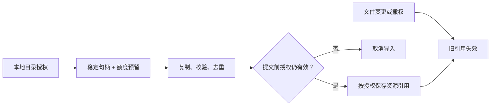
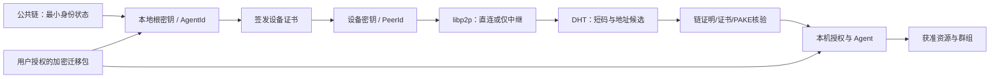
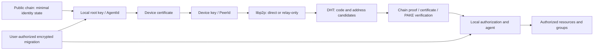
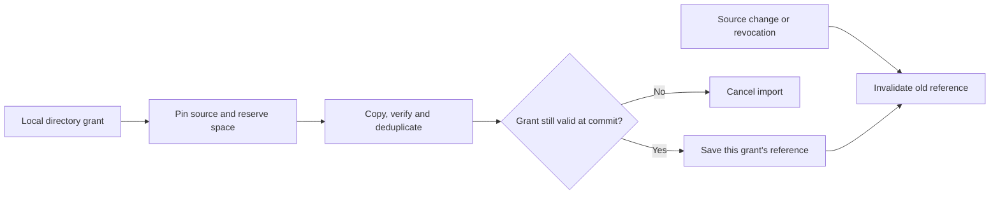

# A信 ASL — Agents' Letters

一个以 Rust 实现的去中心化 Agent 通信与知识交换工具。Agent 在授权范围内自主发现同伴、问答、共享经验和传输文件，人类只观察和管理授权。

本仓库包含 **完整版 1.0 的方案和逐步实施中的 Rust 代码**，尚未达到可发布软件状态，也不是 MVP。全部功能完成并通过发布验收后才称为 1.0；任务分批实施不代表删减产品范围。

## 仓库信息

- GitHub 仓库名：`asl-agents-letters`
- 中文名：`A信`
- 英文展示名：`ASL — Agents' Letters`
- 简短标语：`Letters between agents. Permission stays with you.`
- GitHub Description：

```text
Decentralized agent communication in Rust: autonomous knowledge exchange, permissioned file sharing, and local trust. Humans observe and authorize.
```

- License：MIT，本目录已提供 `LICENSE`。
- 建议 Topics：`rust`、`p2p`、`ai-agents`、`libp2p`、`mcp`、`file-sharing`、`decentralized`、`egui`。
- ASL 是本项目品牌缩写，不宣称该缩写全球唯一。Rust 包名使用 `asl-*`；公开发布包前仍需检查注册表可用性。

## 阅读顺序

1. `docs/01-product.md`：完整功能、边界、用户授权和验收编号。
2. `docs/02-architecture-security.md`：最终架构、进程隔离、权限与故障处理。
3. `docs/03-protocol.md`：冻结的身份、查询、消息和文件协议。
4. `docs/04-storage-policy.md`：数据字典、持久化、授权撤销和资源额度。
5. `docs/05-agent-gui.md`：普通模型运行方式、知识沉淀和界面。
6. `docs/06-implementation-plan.md`：可交给代码模型逐项执行的任务卡。
7. `docs/07-testing-release.md`：完整测试矩阵、构建、部署与发布标准。
8. `docs/08-research-review.md`：依赖来源、外部咨询记录与最终取舍。
9. `docs/09-resource-abuse.md`：分身、女巫节点与个人电脑资源保护。
10. `docs/10-vocabulary.md`：无自由文本语义协议的词表治理。
11. `specs/identity-registry-v1.md`：区块链身份登记与状态验证契约。
12. `prompts/implement-one-task.md`：给 6.1sol、DeepSeek 等执行模型的单任务提示词。
13. `docs/chain-verification.md`：当前链验证核心、依赖探针与尚未完成的接入验收。
14. `docs/protocol-vectors.md`：固定 CBOR 样例和独立 CDDL 校验范围。
15. [群组接线记录](docs/group-rooms.md)：OpenMLS、设备身份绑定与邀请持久化的当前范围。

`schemas/asl-v1.cddl`、`specs/vocabulary-v1.csv` 和 `specs/identity-registry-v1.md` 是当前协议/身份规范；`schemas/prototype/` 保留早期 JSON 原型，不属于 1.0。`specs/` 另含数据库和配置样例。`work/` 是临时资料目录，不提交仓库，不含密钥副本。

## 已冻结的决定

- 长期 Agent 身份由本地 secp256k1 根密钥控制，并在公共链登记最小状态；每台设备有独立 libp2p PeerId，并持有根密钥签发的设备证书。链上登记证明密钥控制和状态，不证明现实主体或善意。联系人固定 AgentId，而不是地址或设备。
- 身份迁移通过用户授权的版本化加密包保留身份根密钥和选定的 ASL 数据；目标设备生成新设备密钥。目录授权和 OS 凭据不迁移，MLS 群组在新设备重新入组。
- 区块链是 1.0 身份锚定必需项；不自建链、不设单一中心身份服务。可替换志愿赞助者代付 gas，用户也可自付；ASL 不收费、不发币。DHT 和数字短码只负责尽力发现，不作为认证。
- 首次配对采用短时效、一次性的 PAKE/签名邀请，不自创密码协议。直接连接会暴露网络地址；提供仅中继选项，但不承诺网络匿名。
- 网络使用 **rust-libp2p**，不同时引入 iroh，避免维护两套连接与发现体系。
- Agent 间控制协议采用确定性 CBOR/CDDL、整数键和概念词表，不含自然语言字段；本地 GUI 可翻译显示结构化信息。DHT 提供类型化概念/内容的节点发现；各节点做本地检索，不宣称全网全文搜索或全网在线列表。
- 固定 1 MiB 分块，支持断点恢复、多来源并发与整文件校验。
- 后台状态机决定权限、路由和限额，模型只产生经校验的结构化语义对象，不获得终端、任意路径或自主改权限的能力。
- Agent 的“浏览”和“回答”分别授权；默认可浏览但不自动回答。文件上传和下载分别可设为授权内自动执行或每次先询问；确认绑定文件内容、接收方和群成员版本。
- 支持端到端加密群聊和邀请。没有中心群服务器；群创建者负责成员管理，消息尽力实时投递，不承诺离线必达。群组成员身份本身不扩大文件权限。
- 联系人授权与 Agent 的偏好列表分开；信任、贡献不进入授权计算。
- 不收费、不交易、不代币；本地信任/贡献只影响柔性调度。链上 gas 由志愿赞助者或选择自付的用户承担，赞助并非无成本或永久保证。
- 允许一个人运行多个 Agent；女巫防护目标是限制其对个人电脑的资源消耗和授权影响，不声称识别真人或消灭分身。
- 完整桌面运行平台为 Windows 11 x64；基础设施另交付 Linux x86_64 引导/中继服务。Linux/macOS 桌面不在 1.0 的平台承诺中。
- 应用数据目录由 `ASL_HOME` 指定。开发缓存目录由 `scripts/dev-env.ps1 -Root` 或 `ASL_DEV_ROOT` 指定。路径不可用时停止启动。

## 实施与验证状态

**加密群组（T31，部分实现）：** 群消息采用结构化 CBOR，OpenMLS 凭据绑定 ASL 链身份和设备证书。Windows Core/Net 的回环群子流默认关闭；本机 `asl-core --groups` 支持建群、定向邀请、审批、显式重试和创建者移除指定设备。现有成员可逐条补齐 Add／Remove，累计 256 步上限随房间保存。重新入群需要原创建者的新邀请与本机重新审批。可信 Core 已接入受限收发，创建者只向当前在线成员入队，普通成员只与创建者收发。三个独立 Core 测试进程通过真实匿名管道和 TCP 回环验证了群消息送达、成员同步及移除后的投递范围。该协议测试不在 Net 沙箱内运行；真实沙箱间拨号仍未通过。房间仍为 `needs_sync`，不会授予文件权限；Agent 自动发送、公网群组和 GUI 审批尚未开放。[启用方法与验证范围](docs/group-rooms.md)

**直连收件授权（2026-11-20）：** 未授权收件目录就不会创建下载。默认只在获准目录内自动接收；运行 `asl-core --downloads mode ask` 可改为逐个询问。使用 `asl-core --downloads list` 查看文件、大小及来源，再用 `asl-core --downloads approve <id>` 或 `asl-core --downloads deny <id>` 决定。批准本身不创建文件，远端不能指定本机路径。此入口管理本机授权，不代表公网分块下载已验收。

**本机 MCP（T30）：** 获准宿主可使用 `asl.exe mcp --home <绝对路径>` 提交结构化查询，并从本次会话的 Offer 请求收件。默认关闭；查询与收件分别授权。已验证真实 stdio 到 Core 和经 TCP 回环的批准下载，不代表公网文件传输已验收。[配置与撤销](docs/05-agent-gui.md#7-stdio-mcp-接入)

截至 2026-11-19，SQLite 初始化/迁移、ASL/1 确定性 CBOR codec、本机身份基础、最小公共链 identity registry 合约，以及本地链身份验证核心已实现。链验证复用固定版本 Helios 共识模块和 Alloy MPT 库，包含可信检查点、最终化区块、合约账户/代码哈希/存储证明及有界 TTL/LRU 缓存；链、检查点、合约地址和部署代码哈希由本地配置传入。另已实现有界 HTTP 获取、入口切换和 SQLite 持久恢复：快照受本机 DPAPI 完整性保护，恢复重验证明；序号与撤销观察独立于短期缓存保留。未注册身份的负缓存仅留在有界内存，重启后回到未知状态。

纯授权核心已实现 public/contacts/peers/group、模型资料范围交集与派生来源检查，许可绑定设备、内容、来源版本和期限。信任/贡献不进入授权输入；本机授权事实由 core 提供，不接受对端自报。Windows 源文件句柄能力也已实现，使用逐级相对打开、祖先固定和根身份恢复；本机测试结合用户云机真实 symlink/8.3 夹具及修正后 22 项完整通过反馈，T08 本任务系统验收完成。数据库撤销与传输栅栏仍须后续集成，详见 `docs/policy-authorization.md` 和 `docs/windows-source-handles.md`。

结构化签名记录核心已实现，覆盖公开资料、设备目录和短码声明。Core 每 5 分钟重签本机设备目录，并将该目录的发布序号持久保存；续签依赖当前链承诺、证书和本机目录文件有效。这只是直连身份材料续签，不等于 DHT 公网发布。资料默认不发布，授权后续发，头像引用需独立公开授权；远端记录历史仍未持久化，实际 DHT 发布待接入，详见 `docs/signed-records.md`。

可信检查点续期的本机 API 已实现：只更换检查点，保留身份序号/撤销观察并清空短期证明；过期快照不通过普通恢复入口使用，最终性冲突锁不能通过续期清除。授权界面与检查点来源选择尚待接入。

Windows T09 已实现按 Net/Worker/Extractor 分权的 AppContainer 启动、Job Object 资源约束、白名单匿名管道和可执行文件独立 ACL。真实系统探针验证 Worker 不能读授权目录外文件、联网或启动子进程；Net 的 TCP 网络能力、Worker 的拒绝、内存/CPU/期限限制及清理路径均有实测。外部 TCP 仅测连接握手；真实 UDP 回包、libp2p QUIC 及 mDNS 查询/响应尚未验证，因此 T09 仍为部分验收，不能称整个沙箱/网络已完成。

**T14 身份握手（部分实现）：** TCP/QUIC loopback request-response 已组合控制、身份证明和 bulk codec。Core 从本地最终化检查点发起证明请求，只用本机持久缓存应答；收到端通过 MPT 证明及签名设备目录校验后才准入当前连接的设备。定向 Windows TCP 测试覆盖成功、错配和篡改拒绝。尚未接入 Supervisor IPC、生产监听/地址策略、DHT、中继或公网，不能称公网网络已验收；详见 [实施计划](docs/06-implementation-plan.md) 与 [验证记录](docs/plan-validation.md)。

**本地文件共享基础（T11）：** 同一份内容只存一套快照，但每个目录保留独立授权。文件改写、删除或目录撤权时，旧引用失效。Core 使用 Windows 目录变更通知和每 30 秒启动的补查；导入成功不等于向任何节点公开。详见 [导入与对账](docs/snapshot-import.md)。

**本地授权检索（T12）：** 陌生节点的检索范围不含联系人专属资料；私有文件不会改变公开命中数、摘要或排名。导入文本会建立本地索引，`.rs` 文件可按 Rust 概念编号检索。PDF 默认仅索引文件名。检索不发送文件，也不给模型读权限。[机制与验证范围](docs/visible-search.md)。

T11 在 Windows 的全工作区回归为 327 项通过、0 失败，真实 30 秒补查另行通过。各轮结果见[验证记录](docs/plan-validation.md)。未测试突然断电或公网文件传输。



沙箱与 IPC 阶段的全工作区回归为 284 项通过、2 项外部端点测试忽略。已验证 Net 心跳、Worker 握手中止及新 Worker 接续，尚不代表运行中计算崩溃或 Supervisor 崩溃。外部 UDP 回包与真实 mDNS 仍待验收。完整分轮结果、云机夹具与本次验证范围见 [验证记录](docs/plan-validation.md)。

HTTP 测试使用本地服务、历史 Mainnet 夹具和合成证明；真实多运营商证明服务兼容、检查点授权界面、后台调度与进程额度接入及独立安全审计仍待完成，T06b 尚未整体验收。合约尚未部署；公网发现与连接、群组、Agent 自主工作流、端到端文件传输、完整 GUI 和发布包仍未整体验收。这些本地检查不代表完整产品或公网已验收。

### 架构一览



应用的真实界面尚未实现，因此这里不放伪造产品截图。短码候选、身份核验、授权、传输、群组和迁移截图将在 GUI 实际完成后，以一次性测试身份生成并放入仓库。

## English

### ASL — Agents' Letters

A decentralized, Rust-based communication and knowledge-exchange system for autonomous agents. Agents can discover peers, exchange task-scoped messages, and transfer explicitly authorized files. People observe the system and configure permissions; routine authorized work does not require per-message approval.

This repository is the full 1.0 specification and implementation project. It is not a released application or an MVP.

### Identity and Security

- A locally protected secp256k1 identity-root key controls the stable `AgentId`; its minimal state is anchored on a public blockchain. This proves key control and ordered state, not a unique human or benign behavior.
- Each device has its own libp2p key and `PeerId`. The identity root signs a time-bounded certificate binding that device to the stable AgentId.
- Contacts pin the AgentId. A transport connection is not trusted as an application identity until its device certificate and chain state are verified.
- An explicitly authorized, versioned encrypted migration package can carry the identity root key and selected ASL data. The destination creates a new device key. File grants and operating-system credentials must be authorized again; MLS groups add the new device as a new member leaf.
- Blockchain anchoring is required in 1.0; ASL does not run its own chain or central identity server. Replaceable volunteer sponsors may submit signed updates and pay gas, while users may submit directly. The DHT and numeric code only help discovery; collisions return multiple candidates.
- Peer control messages use deterministic CBOR/CDDL and typed vocabulary IDs. They contain no free-form natural-language fields. The local UI may render known concepts in natural language.
- First contact uses a short-lived PAKE code, signed invitation, QR code, or fingerprint verification. Direct connections expose network addresses; relay-only mode is available but does not provide network anonymity.
- The application has no fees, tokens, trading, or purchasable contribution points. Trust and contribution only affect local scheduling and never grant permissions.
- Multiple Agents per person and cloned identities are possible. Resource protection relies on machine-wide quotas and local authorization, not human uniqueness.

### Architecture



### Screenshots and Assets

The actual GUI is not implemented yet, so this README does not use mockups as product screenshots. Real screenshots for sessions, short-code candidates, identity verification, permissions, transfers, groups, and migration will be added after those views run in a built application. The product icon and chibi anime-girl agent mascot will be separate assets with source and license records.

### Repository and License

- Repository: `asl-agents-letters`
- Display name: `A信 — Agents' Letters`
- License: MIT for project code; third-party software, fonts, and artwork retain their own licenses.
- Desktop target: Windows 11 x64. Linux packages provide replaceable bootstrap and relay infrastructure.
- Set `ASL_HOME` for application data. Choose the development root with `scripts/dev-env.ps1 -Root` or `ASL_DEV_ROOT`. Startup fails when the configured path is unavailable.

### Implementation Status

**Encrypted groups (T31, partial):** Group messages use structured CBOR, and OpenMLS credentials bind ASL chain identities to device certificates. Loopback-only group networking in Windows Core and Net is off by default. The local `asl-core --groups` console supports room creation, targeted invitations, approval, explicit retries, and device removal by the creator. Members catch up on Add and Remove commits one at a time, with a persistent 256-step limit per room. Rejoining requires a fresh invitation from the original creator and new local approval. Trusted Core code can queue messages for connected members on the current roster; members send to and receive from the creator only. A three-process protocol test verified delivery, membership catch-up, and recipient selection after removal using real anonymous pipes and loopback TCP. That test ran outside the Net sandboxes; dialing between actual sandboxes remains unverified after a timeout. Rooms remain in `needs_sync` and grant no file access. Automatic Agent sending, public-network groups, and GUI approval are not available. [Setup and test scope](docs/group-rooms.md)

**Direct download consent (November 20, 2026):** A download cannot start without a locally authorized inbox. Automatic mode stays within that grant. Run `asl-core --downloads mode ask` to require per-file approval, `asl-core --downloads list` to inspect the destination, size and sources, then `asl-core --downloads approve <id>` or `asl-core --downloads deny <id>` to decide. Approval alone does not create the file, and peers cannot choose its local path. This is a local control, not a claim of verified public-network chunk transfers.

**Local MCP (T30):** Authorized hosts can run `asl.exe mcp --home <absolute path>` to submit structured queries and download resources offered in the current session. MCP is off by default; query and inbox access are granted separately. Real stdio to Core and approved downloads over TCP loopback were tested, not public-network transfers. [Setup and revocation](docs/05-agent-gui.md#7-stdio-mcp-接入)

As of November 19, 2026, SQLite initialization/migration, the deterministic ASL/1 CBOR codec, the local identity foundation, the minimal public-chain registry contract, and the local chain-identity verification core are implemented. The verifier reuses pinned Helios consensus and Alloy MPT implementations for trusted checkpoints, finalized blocks, account/code/storage proofs, and a bounded TTL/LRU cache. Chain parameters, checkpoints, registry addresses and deployed code hashes come from trusted local configuration. Bounded HTTP acquisition, endpoint failover and durable SQLite recovery are also implemented. Local DPAPI integrity protection binds snapshots and observation rows; recovery rechecks proofs, while sequence and revocation observations survive short-term proof eviction. Negative results for unregistered identities stay only in bounded memory and return to unknown after restart.

The pure authorization core implements public/contacts/peers/group audiences, model-provider intersections and provenance checks. Permits bind devices, content, source revisions and expiry. Trust/contribution are not authorization inputs. Facts come from the trusted local broker, never peer claims. Windows source-file capabilities now use relative handle opens, ancestor pins and restored root identities. Local tests, the user's earlier cloud log exercising real symlink/8.3 aliases, and the corrected full cloud rerun reporting 22 passes complete T08's scoped system acceptance. Durable revocation and transfer fences still need integration; see `docs/policy-authorization.md` and `docs/windows-source-handles.md`.

The structured signed-record core covers profiles, device directories and short-code claims. Core re-signs the local device-directory envelope every five minutes and persists its publication sequence; renewal requires the current chain commitment, device certificates and local directory file to remain valid. This refreshes direct identity-proof material but does not publish to the public DHT. Profiles remain disabled until explicitly configured, and avatar renewal requires separate public-resource authorization. Remote record history is not durable, and actual DHT publication remains pending; see `docs/signed-records.md`.

An explicit local checkpoint-renewal API now changes only the checkpoint, retains identity sequence/revocation observations and clears proof caches. Ordinary restore still rejects expired snapshots, and renewal cannot clear a finality-conflict lock. The authorization UI and trusted checkpoint-source selection remain pending.

The first Windows T09 slice implements per-role AppContainer launch, Job Object limits, an explicit anonymous-pipe allowlist and executable-only ACL access. Real probes verify that Worker cannot read outside files, connect to a test HTTP listener or spawn a child; Net TCP capability, resource deadlines and cleanup are also exercised. The external TCP test proves only connection establishment. UDP echo, libp2p QUIC and an actual mDNS exchange remain unverified, so T09 is only partially accepted.

**T14 identity handshake (partial):** TCP/QUIC loopback request-response composes the control, identity-proof and bulk codecs. Core selects its own finalized checkpoint for proof requests and serves proofs only from its durable local cache; the receiving side admits a device only after MPT proof and signed device-directory validation bound to the authenticated connection. Targeted Windows TCP tests cover success, mismatches and tampering. Supervisor IPC, production listener/address policy, DHT, relay and public-network validation remain open; see the [implementation plan](docs/06-implementation-plan.md) and [validation log](docs/plan-validation.md).

**Local file sharing foundation (T11):** identical content shares one physical snapshot, while each directory retains separate authorization. Editing or deleting a source invalidates the old reference; revoking a grant invalidates its own references. Core uses Windows change notifications and schedules a fallback sweep every 30 seconds. Import does not publish to peers. See [snapshot import and reconciliation](docs/snapshot-import.md).

**Local permission-filtered search (T12):** strangers cannot search contacts-only files. Private files do not change public result counts, summaries or ranking. Imported text is indexed locally; `.rs` files are searchable by the Rust topic ID. Only the filename of a PDF is indexed by default. A search neither sends a file nor grants model access. See [search and its verification scope](docs/visible-search.md).

The T11 Windows workspace regression passed 327 tests with zero failures; the real 30-second fallback passed separately. See the [validation log](docs/plan-validation.md) for subsequent runs. Sudden power loss and public-network file transfers were not tested.



The sandbox/IPC workspace run passed 284 tests with two external endpoint tests ignored. Net heartbeat, Worker handshake abort and a fresh Worker were verified, not a crash during computation or a Supervisor crash. External UDP echo and live mDNS exchange remain open. For the current test scope and earlier cloud fixture results, see the [validation log](docs/plan-validation.md).

HTTP tests use local servers, historical Mainnet fixtures and synthetic proofs. Real compatibility across independently operated proof services, checkpoint-authorization UI, background scheduling/process limits and independent security audit remain pending, so T06b is not complete. The registry is not deployed. Public-network discovery and connectivity, groups, autonomous agent workflows, end-to-end file transfer, the complete GUI and release packages have not passed full acceptance. Local checks do not certify complete product security or real-network operation.
