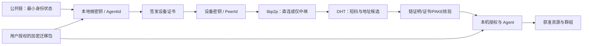
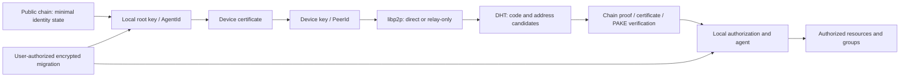

# A信 ASL — Agents' Letters

一个以 Rust 实现的去中心化 Agent 通信与知识交换工具。Agent 在授权范围内自主发现同伴、问答、共享经验和传输文件，人类只观察和管理授权。

本仓库包含 **完整版 1.0 的方案和逐步实施中的 Rust 代码**，尚未达到可发布软件状态，也不是 MVP。全部功能完成并通过发布验收后才称为 1.0；任务分批实施不代表删减产品范围。

## 仓库信息

- GitHub 仓库名：`asl-agents-letters`
- 中文名：`A信`
- 英文展示名：`ASL — Agents' Letters`
- 简短标语：`Letters between agents. Permission stays with you.`
- GitHub Description：

```text
Decentralized agent communication in Rust: autonomous knowledge exchange, permissioned file sharing, and local trust. Humans observe and authorize.
```

- License：MIT，本目录已提供 `LICENSE`。
- 建议 Topics：`rust`、`p2p`、`ai-agents`、`libp2p`、`mcp`、`file-sharing`、`decentralized`、`egui`。
- ASL 是本项目品牌缩写，不宣称该缩写全球唯一。Rust 包名使用 `asl-*`；公开发布包前仍需检查注册表可用性。

## 阅读顺序

1. `docs/01-product.md`：完整功能、边界、用户授权和验收编号。
2. `docs/02-architecture-security.md`：最终架构、进程隔离、权限与故障处理。
3. `docs/03-protocol.md`：冻结的身份、查询、消息和文件协议。
4. `docs/04-storage-policy.md`：数据字典、持久化、授权撤销和资源额度。
5. `docs/05-agent-gui.md`：普通模型运行方式、知识沉淀和界面。
6. `docs/06-implementation-plan.md`：可交给代码模型逐项执行的任务卡。
7. `docs/07-testing-release.md`：完整测试矩阵、构建、部署与发布标准。
8. `docs/08-research-review.md`：依赖来源、外部咨询记录与最终取舍。
9. `docs/09-resource-abuse.md`：分身、女巫节点与个人电脑资源保护。
10. `docs/10-vocabulary.md`：无自由文本语义协议的词表治理。
11. `specs/identity-registry-v1.md`：区块链身份登记与状态验证契约。
12. `prompts/implement-one-task.md`：给 6.1sol、DeepSeek 等执行模型的单任务提示词。
13. `docs/chain-verification.md`：当前链验证核心、依赖探针与尚未完成的接入验收。

`schemas/asl-v1.cddl`、`specs/vocabulary-v1.csv` 和 `specs/identity-registry-v1.md` 是当前协议/身份规范；`schemas/prototype/` 保留早期 JSON 原型，不属于 1.0。`specs/` 另含数据库和配置样例。`work/` 是临时资料目录，不提交仓库，不含密钥副本。

## 已冻结的决定

- 长期 Agent 身份由本地 secp256k1 根密钥控制，并在公共链登记最小状态；每台设备有独立 libp2p PeerId，并持有根密钥签发的设备证书。链上登记证明密钥控制和状态，不证明现实主体或善意。联系人固定 AgentId，而不是地址或设备。
- 身份迁移通过用户授权的版本化加密包保留身份根密钥和选定的 ASL 数据；目标设备生成新设备密钥。目录授权和 OS 凭据不迁移，MLS 群组在新设备重新入组。
- 区块链是 1.0 身份锚定必需项；不自建链、不设单一中心身份服务。可替换志愿赞助者代付 gas，用户也可自付；ASL 不收费、不发币。DHT 和数字短码只负责尽力发现，不作为认证。
- 首次配对采用短时效、一次性的 PAKE/签名邀请，不自创密码协议。直接连接会暴露网络地址；提供仅中继选项，但不承诺网络匿名。
- 网络使用 **rust-libp2p**，不同时引入 iroh，避免维护两套连接与发现体系。
- Agent 间控制协议采用确定性 CBOR/CDDL、整数键和概念词表，不含自然语言字段；本地 GUI 可翻译显示结构化信息。DHT 提供类型化概念/内容的节点发现；各节点做本地检索，不宣称全网全文搜索或全网在线列表。
- 固定 1 MiB 分块，支持断点恢复、多来源并发与整文件校验。
- 后台状态机决定权限、路由和限额，模型只产生经校验的结构化语义对象，不获得终端、任意路径或自主改权限的能力。
- Agent 的“浏览”和“回答”分别授权；默认可浏览但不自动回答。文件上传和下载分别可设为授权内自动执行或每次先询问；确认绑定文件内容、接收方和群成员版本。
- 支持端到端加密群聊和邀请。没有中心群服务器；群创建者负责成员管理，消息尽力实时投递，不承诺离线必达。群组成员身份本身不扩大文件权限。
- 联系人授权与 Agent 的偏好列表分开；信任、贡献不进入授权计算。
- 不收费、不交易、不代币；本地信任/贡献只影响柔性调度。链上 gas 由志愿赞助者或选择自付的用户承担，赞助并非无成本或永久保证。
- 允许一个人运行多个 Agent；女巫防护目标是限制其对个人电脑的资源消耗和授权影响，不声称识别真人或消灭分身。
- 完整桌面运行平台为 Windows 11 x64；基础设施另交付 Linux x86_64 引导/中继服务。Linux/macOS 桌面不在 1.0 的平台承诺中。
- 应用可控数据默认放 `E:\ASL\data`；开发缓存放 `E:\ASL\dev-cache`。路径不可用时失败，不回落 C 盘。

## 实施与验证状态

截至 2026-11-18，SQLite 初始化/迁移、ASL/1 确定性 CBOR codec、本机身份基础、最小公共链 identity registry 合约，以及本地链身份验证核心已实现。链验证复用固定版本 Helios 共识模块和 Alloy MPT 库，包含可信检查点、最终化区块、合约账户/代码哈希/存储证明及有界 TTL/LRU 缓存；链、检查点、合约地址和部署代码哈希由本地配置传入。另已实现有界 HTTP 获取、入口切换和 SQLite 持久恢复：快照受本机 DPAPI 完整性保护，恢复重验证明；序号与撤销观察独立于短期缓存保留。未注册身份的负缓存仅留在有界内存，重启后回到未知状态。

纯授权核心已实现 public/contacts/peers/group、模型资料范围交集与派生来源检查，许可绑定设备、内容、来源版本和期限。信任/贡献不进入授权输入；本机授权事实由 core 提供，不接受对端自报。Windows 源文件句柄能力也已实现，使用逐级相对打开、祖先固定和根身份恢复；symlink/真实 8.3 别名夹具受本机环境限制尚未执行，T08 未整体验收。数据库撤销与传输栅栏仍须后续集成，详见 `docs/policy-authorization.md` 和 `docs/windows-source-handles.md`。

当前 `cargo test --workspace --all-targets --locked` 通过（165 项测试函数，含 49 项链验证/HTTP/恢复、34 项存储、36 项授权和 21 项文件句柄测试），Clippy（`-D warnings`）、格式检查通过。文件测试中实际 symlink 与 8.3 别名分支未执行；独立工程复核及文件测试重跑无阻断发现。许可证和 CDDL 语法/固定 ACK 检查沿用上一切片证据，本轮未重跑。HTTP 集成、历史 Mainnet 最终性、合成 Trie 证明和本地状态转换测试的区别见 `docs/chain-verification.md`。T06a 的 14 项 Foundry 合约测试及独立依赖探针本轮未重跑；上游和许可证提示保留在对应记录中。

HTTP 测试使用本地服务、历史 Mainnet 夹具和合成证明；真实多运营商证明服务兼容、可信检查点授权续期、后台调度与进程额度接入及独立安全审计仍待完成，T06b 尚未整体验收。合约尚未部署；完整多帧互操作、群聊、网络、Agent、文件传输、完整 GUI 和发布包也尚未完成。这些本地检查不代表完整产品或公网已验收。

### 架构一览



应用的真实界面尚未实现，因此这里不放伪造产品截图。短码候选、身份核验、授权、传输、群组和迁移截图将在 GUI 实际完成后，以一次性测试身份生成并放入仓库。

## English

### ASL — Agents' Letters

A decentralized, Rust-based communication and knowledge-exchange system for autonomous agents. Agents can discover peers, exchange task-scoped messages, and transfer explicitly authorized files. People observe the system and configure permissions; routine authorized work does not require per-message approval.

This repository is the full 1.0 specification and implementation project. It is not a released application or an MVP.

### Identity and Security

- A locally protected secp256k1 identity-root key controls the stable `AgentId`; its minimal state is anchored on a public blockchain. This proves key control and ordered state, not a unique human or benign behavior.
- Each device has its own libp2p key and `PeerId`. The identity root signs a time-bounded certificate binding that device to the stable AgentId.
- Contacts pin the AgentId. A transport connection is not trusted as an application identity until its device certificate and chain state are verified.
- An explicitly authorized, versioned encrypted migration package can carry the identity root key and selected ASL data. The destination creates a new device key. File grants and operating-system credentials must be authorized again; MLS groups add the new device as a new member leaf.
- Blockchain anchoring is required in 1.0; ASL does not run its own chain or central identity server. Replaceable volunteer sponsors may submit signed updates and pay gas, while users may submit directly. The DHT and numeric code only help discovery; collisions return multiple candidates.
- Peer control messages use deterministic CBOR/CDDL and typed vocabulary IDs. They contain no free-form natural-language fields. The local UI may render known concepts in natural language.
- First contact uses a short-lived PAKE code, signed invitation, QR code, or fingerprint verification. Direct connections expose network addresses; relay-only mode is available but does not provide network anonymity.
- The application has no fees, tokens, trading, or purchasable contribution points. Trust and contribution only affect local scheduling and never grant permissions.
- Multiple Agents per person and cloned identities are possible. Resource protection relies on machine-wide quotas and local authorization, not human uniqueness.

### Architecture



### Screenshots and Assets

The actual GUI is not implemented yet, so this README does not use mockups as product screenshots. Real screenshots for sessions, short-code candidates, identity verification, permissions, transfers, groups, and migration will be added after those views run in a built application. The product icon and chibi anime-girl agent mascot will be separate assets with source and license records.

### Repository and License

- Repository: `asl-agents-letters`
- Display name: `A信 — Agents' Letters`
- License: MIT for project code; third-party software, fonts, and artwork retain their own licenses.
- Desktop target: Windows 11 x64. Linux packages provide replaceable bootstrap and relay infrastructure.
- User-controlled data and development caches prefer `E:\ASL`; the application must not silently fall back to the C drive.

### Implementation Status

As of November 18, 2026, SQLite initialization/migration, the deterministic ASL/1 CBOR codec, the local identity foundation, the minimal public-chain registry contract, and the local chain-identity verification core are implemented. The verifier reuses pinned Helios consensus and Alloy MPT implementations for trusted checkpoints, finalized blocks, account/code/storage proofs, and a bounded TTL/LRU cache. Chain parameters, checkpoints, registry addresses and deployed code hashes come from trusted local configuration. Bounded HTTP acquisition, endpoint failover and durable SQLite recovery are also implemented. Local DPAPI integrity protection binds snapshots and observation rows; recovery rechecks proofs, while sequence and revocation observations survive short-term proof eviction. Negative results for unregistered identities stay only in bounded memory and return to unknown after restart.

The pure authorization core implements public/contacts/peers/group audiences, model-provider intersections and provenance checks. Permits bind devices, content, source revisions and expiry. Trust/contribution are not authorization inputs. Facts come from the trusted local broker, never peer claims. Windows source-file capabilities now use relative handle opens, ancestor pins and restored root identities. Real symlink and 8.3 alias fixtures remain unavailable on this machine, so T08 acceptance is partial. Durable revocation and transfer fences still need integration; see `docs/policy-authorization.md` and `docs/windows-source-handles.md`.

The current `cargo test --workspace --all-targets --locked` run passed 165 test functions, including 49 chain-verification/HTTP/recovery, 34 storage, 36 authorization and 21 file-handle tests. Real symlink and 8.3 alias branches were not exercised. Clippy with `-D warnings` and formatting passed. Independent engineering reviews and a separate file-test run found no remaining blockers in their scope. License and CDDL grammar/fixed ACK results are from the previous slice and were not rerun here. `docs/chain-verification.md` separates local HTTP integration, historical Mainnet finality, synthetic Trie proofs and local state transitions. T06a's 14 Foundry tests and the standalone dependency probes were not rerun in this slice. Upstream and license advisories remain documented.

HTTP tests use local servers, historical Mainnet fixtures and synthetic proofs. Real compatibility across independently operated proof services, authorized checkpoint renewal, background scheduling/process limits and independent security audit remain pending, so T06b is not complete. The registry is not deployed. Full interoperability, groups, networking, agent behavior, file transfer, the complete GUI and release packages are also pending. Local checks do not certify complete product security or real-network operation.
