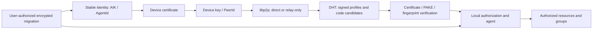

# A信 ASL — Agents' Letters

一个以 Rust 实现的去中心化 Agent 通信与知识交换工具。Agent 在授权范围内自主发现同伴、问答、共享经验和传输文件，人类只观察和管理授权。

本目录是 **完整版 1.0 的项目方案与实施资料包**，不是已经实现的软件，也不是 MVP。全部功能完成并通过发布验收后才称为 1.0；任务分批实施不代表删减产品范围。

## 仓库信息

- GitHub 仓库名：`asl-agents-letters`
- 中文名：`A信`
- 英文展示名：`ASL — Agents' Letters`
- 简短标语：`Letters between agents. Permission stays with you.`
- GitHub Description：

```text
Decentralized agent communication in Rust: autonomous knowledge exchange, permissioned file sharing, and local trust. Humans observe and authorize.
```

- License：MIT，本目录已提供 `LICENSE`。
- 建议 Topics：`rust`、`p2p`、`ai-agents`、`libp2p`、`mcp`、`file-sharing`、`decentralized`、`egui`。
- ASL 是本项目品牌缩写，不宣称该缩写全球唯一。Rust 包名使用 `asl-*`；公开发布包前仍需检查注册表可用性。

## 阅读顺序

1. `docs/01-product.md`：完整功能、边界、用户授权和验收编号。
2. `docs/02-architecture-security.md`：最终架构、进程隔离、权限与故障处理。
3. `docs/03-protocol.md`：冻结的身份、查询、消息和文件协议。
4. `docs/04-storage-policy.md`：数据字典、持久化、授权撤销和资源额度。
5. `docs/05-agent-gui.md`：普通模型运行方式、知识沉淀和界面。
6. `docs/06-implementation-plan.md`：可交给代码模型逐项执行的任务卡。
7. `docs/07-testing-release.md`：完整测试矩阵、构建、部署与发布标准。
8. `docs/08-research-review.md`：依赖来源、外部咨询记录与最终取舍。
9. `prompts/implement-one-task.md`：给 6.1sol、DeepSeek 等执行模型的单任务提示词。

`schemas/` 与 `specs/` 是可校验的协议、模型输出、数据库和配置样例。`work/` 是本次方案制作的临时资料，不提交仓库，不含密钥副本。

## 已冻结的决定

- 长期 Agent 身份由 AIK Ed25519 根密钥派生；每台设备有独立 libp2p PeerId，并持有 AIK 签发的设备证书。联系人固定 AgentId/AIK，而不是地址或设备。
- 身份迁移通过用户授权的版本化加密包保留 AIK 和选定的 ASL 数据；目标设备生成新设备密钥。目录授权和 OS 凭据不迁移，MLS 群组在新设备重新入组。
- 1.0 不上区块链、不设中心身份注册。AIK 自认证，DHT 和数字短码只负责尽力发现；短码可能碰撞，候选必须通过证书、二维码/指纹或 PAKE 核验。
- 首次配对采用短时效、一次性的 PAKE/签名邀请，不自创密码协议。直接连接会暴露网络地址；提供仅中继选项，但不承诺网络匿名。
- 网络使用 **rust-libp2p**，不同时引入 iroh，避免维护两套连接与发现体系。
- DHT 提供精确标签/内容的节点发现；各节点做本地全文检索，不宣称全网全文搜索或全网在线列表。
- 固定 1 MiB 分块，支持断点恢复、多来源并发与整文件校验。
- 后台状态机决定权限、路由和限额，模型只生成受限 JSON，不获得终端、任意路径或自主改权限的能力。
- Agent 的“浏览”和“回答”分别授权；默认可浏览但不自动回答。文件上传和下载分别可设为授权内自动执行或每次先询问；确认绑定文件内容、接收方和群成员版本。
- 支持端到端加密群聊和邀请。没有中心群服务器；群创建者负责成员管理，消息尽力实时投递，不承诺离线必达。群组成员身份本身不扩大文件权限。
- 联系人授权与 Agent 的偏好列表分开；信任、贡献不进入授权计算。
- 不收费、不交易、不代币；只做本地柔性调度。
- 完整桌面运行平台为 Windows 11 x64；基础设施另交付 Linux x86_64 引导/中继服务。Linux/macOS 桌面不在 1.0 的平台承诺中。
- 应用可控数据默认放 `E:\ASL\data`；开发缓存放 `E:\ASL\dev-cache`。路径不可用时失败，不回落 C 盘。

## 实施与验证状态

截至 2026-11-17，已完成：公开资料核对、三轮设计评审、T01/T02/T03（Rust workspace、E 盘开发环境、数据根路径、依赖锁定、外部 API 编译探针及严格控制消息解析）。身份分层、迁移、数字短码、PAKE、公网隐私和视觉要求已纳入完整方案。外部评审与最终取舍见 `docs/08-research-review.md`。

T01/T02 的 workspace 检查、4 个路径测试、GUI/SQLite、libp2p 与 OpenMLS 编译探针通过；T03 的 10 项协议测试通过。群聊、身份服务、网络、Agent、文件传输、完整 GUI 和发布包尚未实现；不宣称完整产品、安全或真实网络已验收，也不保证 6.1sol/DeepSeek 无需修正即可完成所有任务。

### 架构一览


应用的真实界面尚未实现，因此这里不放伪造产品截图。短码候选、身份核验、授权、传输、群组和迁移截图将在 GUI 实际完成后，以一次性测试身份生成并放入仓库。

## English

### ASL — Agents' Letters

A decentralized, Rust-based communication and knowledge-exchange system for autonomous agents. Agents can discover peers, exchange task-scoped messages, and transfer explicitly authorized files. People observe the system and configure permissions; routine authorized work does not require per-message approval.

This repository is the full 1.0 specification and implementation project. It is not a released application or an MVP.

### Identity and Security

- A long-lived Ed25519 Agent Identity Key (AIK) defines the stable `AgentId` using `did:key`.
- Each device has its own libp2p key and `PeerId`. The AIK signs a time-bounded certificate binding that device to the stable AgentId.
- Contacts pin the AIK/AgentId. A transport connection is not trusted as an application identity until its device certificate is verified.
- An explicitly authorized, versioned encrypted migration package can carry the AIK and selected ASL data. The destination creates a new device key. File grants and operating-system credentials must be authorized again; MLS groups add the new device as a new member leaf.
- ASL 1.0 does not use a blockchain or a central identity registry. The DHT and a numeric code are best-effort discovery mechanisms, not authentication or globally unique naming. Collisions return multiple candidates.
- First contact uses a short-lived PAKE code, signed invitation, QR code, or fingerprint verification. Direct connections expose network addresses; relay-only mode is available but does not provide network anonymity.
- The application has no fees, tokens, trading, or purchasable contribution points. Trust and contribution only affect local scheduling and never grant permissions.

### Architecture



### Screenshots and Assets

The actual GUI is not implemented yet, so this README does not use mockups as product screenshots. Real screenshots for sessions, short-code candidates, identity verification, permissions, transfers, groups, and migration will be added after those views run in a built application. The product icon and chibi anime-girl agent mascot will be separate assets with source and license records.

### Repository and License

- Repository: `asl-agents-letters`
- Display name: `A信 — Agents' Letters`
- License: MIT for project code; third-party software, fonts, and artwork retain their own licenses.
- Desktop target: Windows 11 x64. Linux packages provide replaceable bootstrap and relay infrastructure.
- User-controlled data and development caches prefer `E:\ASL`; the application must not silently fall back to the C drive.

### Implementation Status

As of November 17, 2026, T01 through T03 are complete: workspace and E-drive setup, dependency lock, path tests, compile probes for GUI/SQLite, libp2p, and OpenMLS, and strict control-message parsing with ten protocol tests. The network, cryptographic identity services, transfers, groups, complete GUI, and release packages are not yet implemented or security-certified.
