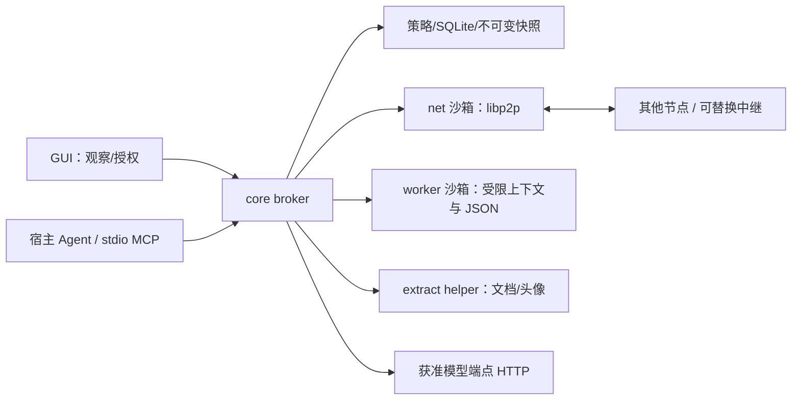

# 架构、安全边界与故障设计

## 1. 最终技术路线

Rust workspace，八个 crate。使用 rust-libp2p 一个网络栈；不同时引入 iroh、iroh-blobs 或第二套 DHT。完整版要求精确标签发现、多个入口、中继、独立文件授权与多来源调度，单栈更便于冻结接口和测试。

固定采用 QUIC + TCP/Noise/Yamux、Kademlia、mDNS、identify、ping、relay v2、AutoNAT、DCUtR 和 request-response。不接入 pubsub，也不广播文件清单；不接 IPFS 的公共 DHT 命名空间。最多 64 人的小组复用现有认证连接逐成员投递，OpenMLS 实现 MLS 群密码学，不自行设计群密钥协议。

候选依赖版本见 `specs/dependency-baseline.json`。版本已查询，但依赖组合尚未编译；必须在任务 T01/T02/T14/T39 编译探针后形成 Cargo.lock，不由模型自行追最新版。

## 2. 进程与数据流



`asl.exe` 是桌面入口和本地 CLI；`asl-core.exe` 是后台 supervisor/broker；`asl-net.exe` 跑网络；`asl-worker.exe` 以不同固定角色执行模型输入输出处理与文档提取。Linux 基础设施使用 `asl-infra`，不接触用户共享目录。

可信计算基包含 core、net 的连接认证适配器和 Windows 权限模块。core 持有身份的静态存储、授权、数据库、资料快照和模型 HTTP 凭据，只执行固定实现，不运行来自模型的代码。net 只能通过有界 IPC 请求已授权操作；worker/helper 无任意文件工具、无直接网络、无宿主私人上下文。

libp2p 握手需要网络进程使用身份私钥。启动时 core 经私有继承管道把该密钥的内存副本交给 net，不能假设库支持未经验证的远程签名接口。net 的沙箱限制文件访问，**不构成“net 被攻陷后仍能保证身份和 contacts 内容安全”的承诺**。连接身份只能取库完成认证后的 PeerId，不能接受消息自报值。net 退出后清除内存副本；凭据从不交给 worker。这里有意保留标准 libp2p 的单身份设计，避免额外发明双身份/应用加密协议。

八个 crate 的依赖图：

```text
asl-types
  ├─ asl-store
  ├─ asl-policy
  ├─ asl-transfer
  └─ asl-net
asl-groups -> types + store；封装 OpenMLS 群状态
asl-agent -> types + store + policy + transfer + groups 的应用接口
asl-app   -> 上述模块；负责进程入口、UI、MCP 和组合
```

不允许 net 直接依赖 store 的数据库连接或 policy 的目录句柄。跨进程只传不可变 DTO、受限字节和短期授权 ID。

`asl-net` 仅将有界不透明 MLS 字节通过认证连接发送给明确的群成员；不为非成员转发群消息。解密、成员状态和群授权留在 core 的 `asl-groups`。入站应用消息只有通过 MLS 验证、PeerId 绑定、当前成员/epoch 检查后才交给 Agent。连接时序和通信双方仍可被观察。

群授权是独立的 audience 类型，不能隐式折算为 `contacts`。群成员变更增加群成员 epoch；群范围 permit、lease 和待处理传输绑定该 epoch，并在发送前重新判定。新成员只有在本地授权该群范围后才能读取群资源。每次询问确认同样绑定接收 PeerId 与群 epoch。

## 3. Windows 隔离

公开无人值守目标为 Windows 11 x64，数据卷要求本地 NTFS。程序检查系统能力、ACL 和隔离启动是否生效；失败进入 `SandboxUnavailable`，不能退回普通权限 worker 继续对外服务。

- net 使用独立 AppContainer 身份，只授予确需的网络能力和 IPC，不授予用户资料目录。
- worker/helper 不授予网络能力或用户目录；仅得到本次操作的输入和输出管道。
- 子进程加入 Job Object，限制内存、CPU 时间、活动进程数和退出联动；活动进程上限为 1，禁止自行启动子进程。
- IPC 使用继承句柄及明确白名单，拒绝继承文件、密钥和数据库句柄；启动环境清除 API Key。
- 可执行文件读/执行 ACL 只授予对应 sandbox SID，不把 E:\ASL 根目录整体开放给它。
- Windows API 与 `unsafe` 集中在 `asl-policy/src/platform/windows/`。不能把低完整性令牌当成 AppContainer 等价替代。

网络能力包括不同地址类型的适配必须真实验证；AppContainer 的网络权限不等于按域名限制出站。外部模型 HTTP 由 core 的固定网关发起。

隔离不能抵抗管理员、内核入侵、同账号调试器或已被攻陷的 core。安全文档必须陈述威胁范围，不能宣传“绝对不泄露”。

## 4. 文件与授权强制点

每项授权包含根目录身份、扩展名、披露范围、模型处理范围、额度、epoch 与状态。contacts 成员变化还会增加全局 `policy_revision`。

访问始终是 `授权句柄 + 受限相对文件标识`，不是 `远端路径 -> open()`。目录遍历和文件打开拒绝 `..`、绝对路径、UNC、设备名、ADS、reparse point，检查卷和目录/文件身份，拒绝硬链接计数大于 1 的源文件。

Windows 实现必须验证句柄相对打开、路径组件替换和重命名竞态；不能只 `canonicalize` 再用普通路径重新打开。cap-std 是可评估的工具，不免除这些测试。

导入时稳定打开源文件、拒绝其他写入/删除并建立不可变快照；需要快照的磁盘额度必须事先取得。模型和 net 从不自行打开原始目录。

grant 的快照引用、文件 hash 和实际字节存储分离。同一 content_id 可物理去重，但不能因“磁盘上有这个 hash”就授权访问。授权判断必须沿 `grant -> resource -> snapshot -> requester` 路径完成。

目录变更由 watcher 加定期全量对账发现；源文件移除后停止新公告和新 lease。此机制有扫描延迟；要求立即停止披露时使用撤销授权。历史已发送副本无法召回。

## 5. 撤销与竞态

短期 permit 包含：

```text
permit_id, grant_id, grant_epoch, policy_revision,
requester_peer_id, content_id, operation, expires_at_ms
```

撤销在同一事务内增加 epoch/revision、停用资源引用并记审计。提交后，core 立即取消相关队列、未开始读取、尚未交给 net 的块和模型调用；每次读取、输出、发送前重新验证 permit。

任何 await 之后继续发送前都需重新验证，不得缓存“曾经允许”作为永远有效。权限变更事件带 revision，net 按序 ACK；新请求不得越过尚未确认的撤销栅栏。grant_epoch 是该 grant 的失效条件；全局 policy_revision 只触发重新判定和审计。无关策略变更不应把所有大文件下载取消。联系人授权变动按 requester 重新判定，撤下该身份时立即使其 permit 失效。

公开承诺是“撤销提交后不再授权新的披露，并尽力取消尚未发出的数据”。已经交给传输层或外部模型端点的数据不可收回，不承诺并发时最多只存在一个在途块。

## 6. 模型与 HTTP 网关

模型只接触为当前接收者获准的片段，候选 ID 不包含路径。模型不能给出 peer 权限、授权、命令、URL、文件位置或额度。schema 正确也不意味着内容真实，所有 refs 还要做集合成员及当前授权检查。

provider 由人预先授权，凭据不传给 worker。HTTP 禁止自动重定向，HTTPS 校验开启，限制响应、时间与重试。URL 来自配置，不来自 peer 或模型。局域网/loopback provider 必须单独授权，拒绝请求元数据地址和任意 URL 抓取。

对外 query 内容本身需要披露许可。接入宿主不等于接管其权限；不能保证过滤宿主主动塞进 query 的任意秘密。

## 7. 资源保护与调度

统一上限是运行保护。默认同时 8 个上传块、单 peer 2 个；每项下载最多 4 个来源、每来源 2 个块；最多 4 个模型任务。每项任务有总轮数、总时间和出站请求数。

公平队列基础份额保证新人机会，可靠性与有效贡献只在同一授权等级内改变权重。硬拒绝违规协议、坏 hash 或额度耗尽不受贡献抵消。

所有队列、DHT 待查、去重记录、记录存储、日志和模型响应都必须有字节/数量/期限三类界限。换身份不能绕过本机总额度。

## 8. 故障语义

| 故障 | 行为 |
| --- | --- |
| 沙箱失败 | 停止对外无人值守能力，GUI 展示原因，禁止普通进程回退 |
| 模型不可用 | 仍可回答确定性资源匹配；自然语言请求返回明确 unavailable |
| DHT 失败 | 继续已知联系人直连，不假造搜索结果 |
| 直连失败 | 尝试获准中继；中继容量不足时等待/失败，不要求永远直连 |
| 磁盘不足 | 先停止新额度预留，保存可恢复状态，不删除用户源文件 |
| 数据库损坏 | 停止权限相关操作，使用明确恢复流程，不重建为空授权 |
| 授权版本冲突 | 拒绝并重新求 permit，不接受旧 grant |
| 版本不兼容 | 返回 incompatible；不能猜测解析未知版本 |

## 9. 中继设计纠正

不采纳“所有大文件都必须直连”的限制，它会破坏方便性和完整传输能力。中继可承载文件，但需配置明确的电路字节、时间和并发上限。每块请求有边界，电路耗尽时保存状态、重连或切换其他允许中继。

不能靠拆连接绕过运营者限额；也不能把“软件不收费”误解成“他人中继资源无限”。发布包附带可替换入口与自托管配置，首次加入仍需至少一个可达入口。

便捷入网由发布包的 `assets/network-seeds.json` 提供至少两个运营配置独立的真实入口，受发布清单签名保护。首次网络授权后自动使用，不要求日常用户手工填写地址。显式 bootstrap 配置优先，缓存的已知节点次之，内置入口最后补充；用户可以禁用内置列表并授权自己的网络。入口不是身份审批机关，关闭维护者更新站不影响已经入网的节点。
